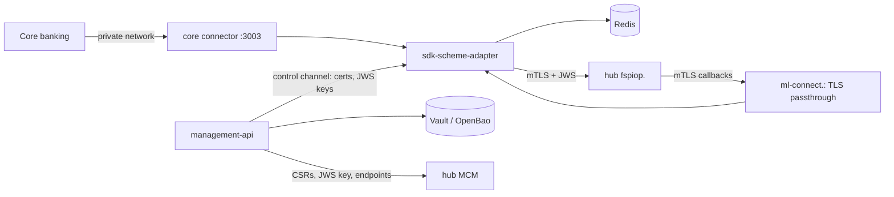

# PM4ML on Kubernetes

Helm deployment of Payment Manager for Mojaloop (PM4ML) for a DFSP joining a
jengacore switch. The defaults match
[JengaCore/pm4ml-docker-compose](https://github.com/JengaCore/pm4ml-docker-compose)
(MCM onboarding, Vault, mTLS and JWS on). Started from
[ThitsaX/pm4ml-deployment](https://github.com/ThitsaX/pm4ml-deployment); why it
changed is in [docs/REVIEW-2026-11.md](docs/REVIEW-2026-11.md).

| Doc | |
|---|---|
| [docs/OPTIONS.md](docs/OPTIONS.md) | every default, its options, and where Helm differs from Compose |
| [docs/SECRET-BACKENDS.md](docs/SECRET-BACKENDS.md) | Vault, OpenBao, managed and cloud options |
| [docs/REVIEW-2026-11.md](docs/REVIEW-2026-11.md) | review of the ThitsaX repo |

## What runs



## Prerequisites

- Kubernetes 1.27+, Helm 3.10+, `kubectl`, `perl`, `openssl`, `python3`
- 2 small volumes (Vault 1 Gi, Redis 2 Gi) from the default StorageClass
- A way to publish `ml-connect.<your domain>` with **TLS passthrough**
  (`networking/`): an L4 load balancer, Istio `PASSTHROUGH`, or ingress-nginx
  started with `--enable-ssl-passthrough`
- Egress to `mcm.`, `keycloak.` and `fspiop.<switch domain>` on 443

## From the hub operator

1. Your DFSP id, created in MCM (the hub calls this "Add DFSP")
2. The client secret of that DFSP's Keycloak client
3. Switch domain, `API_TYPE`, currency

You give the hub: the callback host `ml-connect.<your domain>` and your egress IP(s).

## Install (default: MCM mode, Vault)

```bash
NS=dfsp                                   # any namespace you own
kubectl create namespace $NS               # if you may
helm repo add pm4ml https://pm4ml.github.io/mojaloop-payment-manager-helm/repo && helm repo update

# 1. Redis and the secret store
kubectl -n $NS apply -f redis/redis.yaml
kubectl -n $NS apply -f secret-store/vault/vault.yaml
NS=$NS STORE=vault ./secret-store/init.sh     # writes ./$NS-store-init.json: move it to escrow

# 2. Secrets (prompts for the client secret)
NS=$NS ./scripts/create-mcm-secrets.sh

# 3. Values: copy, fill every CHANGE ME
cp helm-values/values-pm4ml.yaml helm-values/values-local.yaml && $EDITOR helm-values/values-local.yaml

# 4. PM4ML
helm upgrade --install pm4ml pm4ml/mojaloop-payment-manager --version 10.3.6 -n $NS \
  -f helm-values/values-local.yaml --post-renderer ./post-render/post-render.sh

# 5. Callback host (pick one of networking/*.yaml), then point DNS at it
kubectl -n $NS apply -f networking/loadbalancer.yaml
```

Then ask the hub operator to sign your enrolment in MCM. Nothing tells them to,
and until they do, the SDK has no client certificate.

`--post-renderer` is required on every install and upgrade. It mounts the
Secrets and reads env values from them, which the charts cannot do.

### OpenBao instead of Vault (unseals itself)

```bash
kubectl -n $NS create secret generic pm4ml-openbao-seal --from-file=unseal.key=<(openssl rand 32)
kubectl -n $NS get secret pm4ml-openbao-seal -o yaml > openbao-seal-BACKUP.yaml   # to escrow
kubectl -n $NS apply -f secret-store/openbao/openbao.yaml
NS=$NS STORE=openbao ./secret-store/init.sh
```

Same Service name, so the Helm values do not change.

### After a restart (Vault only)

```bash
NS=$NS ./secret-store/unseal.sh        # 3 of the 5 keys
```

management-api waits for the store. Transfers keep running on the certificates
already loaded.

### Static mode (no management-api, no Vault)

```bash
NS=$NS TLS_DIR=./tls ./scripts/create-static-secrets.sh      # see its header for the files
cp helm-values/values-jws-peers.example.yaml helm-values/values-jws-peers.yaml   # Hub + peers
helm upgrade --install pm4ml pm4ml/mojaloop-payment-manager --version 10.3.6 -n $NS \
  -f helm-values/values-local.yaml -f helm-values/values-static.yaml \
  -f helm-values/values-jws-peers.yaml --post-renderer ./post-render/post-render.sh
```

## Check

```bash
kubectl -n $NS get pods
kubectl -n $NS logs deploy/pm4ml-management-api | grep -E 'eventType|error' | tail
openssl s_client -connect ml-connect.<your domain>:443 -servername ml-connect.<your domain> </dev/null 2>/dev/null \
  | openssl x509 -noout -subject -issuer       # must be your MCM-issued server cert
```

| Symptom | Cause |
|---|---|
| management-api: `401 invalid_client` | DFSP not created in MCM yet, or wrong client secret |
| SDK restarts: `Validation keys must be supplied` | management-api has no peer JWS keys yet (see the row above) |
| `ipList[0].address should match pattern` | `WHITELIST_IP` must be bare IPv4 addresses, not CIDR |
| `DFSP_CLIENT_CERT: pending` | the hub has not signed your enrolment |
| `3101 Invalid accept header` | `API_TYPE` differs from the hub's |
| `JWS public key for 'Hub' not available` | the hub has not published its JWS key through MCM |

More failure modes: switch-iac `docs/DFSP-ONBOARDING.md`.

## Validation status

| Check | Result |
|---|---|
| Chart renders, both modes, with the post-renderer | ✓ |
| Vault 1.13.3: init, unseal, AppRole; management-api logs in and keeps its state machine in it | ✓ 2026-11-18, Coder cluster |
| OpenBao 2.6.5: same, plus a process restart that unsealed itself | ✓ 2026-11-18 |
| management-api reaches the sbx UAT hub's Keycloak and MCM | ✓ (`401`: DFSP not admitted, as expected) |
| SDK connects to management-api's control channel | ✓ |
| Admission, signing, callbacks, transfers in both directions with JWS on | **pending**: needs a DFSP admitted on a hub |
| EKS / AKS run | pending |

## Operations

Each DFSP runs its own PM4ML. Logs, monitoring, backups and infrastructure
troubleshooting are the DFSP's job. Back up the store (or its unseal key) and
the namespace's Secrets off-cluster: losing the DFSP CA means onboarding again.
