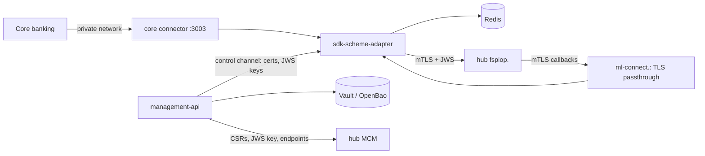

# PM4ML on Kubernetes

Helm deployment of Payment Manager for Mojaloop (PM4ML) for a DFSP joining a
jengacore switch. The defaults match
[JengaCore/pm4ml-docker-compose](https://github.com/JengaCore/pm4ml-docker-compose)
(MCM onboarding, Vault, mTLS and JWS on). Started from
[ThitsaX/pm4ml-deployment](https://github.com/ThitsaX/pm4ml-deployment); why it
changed is in [docs/REVIEW-2026-11.md](docs/REVIEW-2026-11.md).

## Recommended: the `pm4ml-dfsp` chart

[`charts/pm4ml-dfsp`](charts/pm4ml-dfsp) is a self-contained Helm chart: one
values file provisions the SDK, management-api, **the DFSP's own core
connector (set `coreConnector.image`)**, the secret store, Redis, the callback
edge, the bootstrap Job and the backup CronJob.

```bash
kubectl -n dfsp create secret generic mydfsp-mcm --from-literal=client-secret='<from the hub>'
helm dependency build charts/pm4ml-dfsp
helm -n dfsp install mydfsp charts/pm4ml-dfsp -f my-values.yaml
```

See [charts/pm4ml-dfsp/README.md](charts/pm4ml-dfsp/README.md) (values
reference, bring your own core connector, examples).

Releases: `oci://ghcr.io/jengacore/charts/pm4ml-dfsp`, signed with cosign,
published by `.github/workflows/chart-release.yml` when `main` carries a new
chart version. Every push runs `.github/workflows/chart-ci.yml` (static checks
in `.github/scripts/chart-checks.sh`, then an install on kind). The
switch-connector-sdk as an alternative to PM4ML is planned for a later version:
[docs/NEXT-SWITCH-CONNECTOR-SDK.md](docs/NEXT-SWITCH-CONNECTOR-SDK.md). The rest of this README
describes the earlier layout (upstream chart + post-renderer + scripts), kept
for existing installs.

| Doc | |
|---|---|
| [docs/BUILDING-BLOCKS.md](docs/BUILDING-BLOCKS.md) | **start here**: the blocks around the core connector, the options for each, the MCM connection, a production-ready cluster |
| [docs/GENERIC-KUBERNETES.md](docs/GENERIC-KUBERNETES.md) | any Kubernetes, no cloud service: end-to-end install, callback options, day 2 |
| [docs/PRODUCTION.md](docs/PRODUCTION.md) | keys and backups, load balancer and mTLS, AWS / Azure / on-prem reference |
| [docs/OPTIONS.md](docs/OPTIONS.md) | every default, its options, and where Helm differs from Compose |
| [docs/SECRET-BACKENDS.md](docs/SECRET-BACKENDS.md) | Vault, OpenBao, managed and cloud options |
| [docs/REVIEW-2026-11.md](docs/REVIEW-2026-11.md) | review of the ThitsaX repo |

## What runs



## Prerequisites

- Kubernetes 1.27+, Helm 3.10+, `kubectl`, `perl`, `openssl`, `python3`
- 2 small volumes (Vault 1 Gi, Redis 2 Gi) from the default StorageClass
- A way to publish `ml-connect.<your domain>` with **TLS passthrough**
  (`networking/`): an L4 load balancer, Istio `PASSTHROUGH`, or ingress-nginx
  started with `--enable-ssl-passthrough`
- Egress to `mcm.`, `keycloak.` and `fspiop.<switch domain>` on 443

## From the hub operator

1. Your DFSP id, created in MCM (the hub calls this "Add DFSP")
2. The client secret of that DFSP's Keycloak client
3. Switch domain, `API_TYPE`, currency

You give the hub: the callback host `ml-connect.<your domain>` and your egress IP(s).

## Install (default: MCM mode, Vault)

```bash
NS=dfsp                                   # any namespace you own
kubectl create namespace $NS               # if you may
helm repo add pm4ml https://pm4ml.github.io/mojaloop-payment-manager-helm/repo && helm repo update

# 1. Redis (production: redis/values-redis-ha.yaml, see the checklist) and the secret store
kubectl -n $NS apply -f redis/redis.yaml
kubectl -n $NS apply -f secret-store/vault/vault.yaml
NS=$NS STORE=vault DFSP_ID=<dfsp id> ./secret-store/init.sh   # writes ./$NS-pm4ml-store-init.json: move it to escrow

# 2. Secrets (prompts for the client secret). With redis/values-redis-ha.yaml: REDIS_HA=1
NS=$NS ./scripts/create-mcm-secrets.sh

# 3. Values: copy, fill every CHANGE ME (with redis-ha: the SDK's redis.host is <release>-redis-ha-haproxy)
cp helm-values/values-pm4ml.yaml helm-values/values-local.yaml && $EDITOR helm-values/values-local.yaml

# 4. PM4ML
helm upgrade --install pm4ml pm4ml/mojaloop-payment-manager --version 10.3.6 -n $NS \
  -f helm-values/values-local.yaml --post-renderer ./post-render/post-render.sh

# 5. Callback host (pick one of networking/*.yaml), then point DNS at it
kubectl -n $NS apply -f networking/loadbalancer.yaml
```

Then ask the hub operator to sign your enrolment in MCM. Nothing tells them to,
and until they do, the SDK has no client certificate.

`--post-renderer` is required on every install and upgrade. It mounts the
Secrets and reads env values from them, which the charts cannot do.

### OpenBao instead of Vault (unseals itself)

```bash
kubectl -n $NS create secret generic pm4ml-openbao-seal --from-file=unseal.key=<(openssl rand 32)
kubectl -n $NS get secret pm4ml-openbao-seal -o yaml > openbao-seal-BACKUP.yaml   # to escrow
kubectl -n $NS apply -f secret-store/openbao/openbao.yaml
NS=$NS STORE=openbao DFSP_ID=<dfsp id> ./secret-store/init.sh
```

Same Service name, so the Helm values do not change.

### Backups (both stores)

```bash
NS=$NS STORE=vault ./secret-store/backup.sh save store.snap                  # snapshot-only AppRole; schedule it, ship off-cluster
NS=$NS STORE=vault OUT=/secure/dir ./scripts/export-identity.sh              # break-glass copy: /secure/dir will hold PRIVATE KEYS
```

What to keep where, and how to restore: [docs/PRODUCTION.md](docs/PRODUCTION.md).

### After a restart (Vault only)

```bash
NS=$NS ./secret-store/unseal.sh        # 3 of the 5 keys
```

management-api waits for the store. Transfers keep running on the certificates
already loaded.

### Static mode (no management-api, no Vault)

```bash
NS=$NS TLS_DIR=./tls ./scripts/create-static-secrets.sh      # see its header for the files
cp helm-values/values-jws-peers.example.yaml helm-values/values-jws-peers.yaml   # Hub + peers
helm upgrade --install pm4ml pm4ml/mojaloop-payment-manager --version 10.3.6 -n $NS \
  -f helm-values/values-local.yaml -f helm-values/values-static.yaml \
  -f helm-values/values-jws-peers.yaml --post-renderer ./post-render/post-render.sh
```

## Check

```bash
kubectl -n $NS get pods
kubectl -n $NS logs deploy/pm4ml-management-api | grep -E 'eventType|error' | tail
openssl s_client -connect ml-connect.<your domain>:443 -servername ml-connect.<your domain> </dev/null 2>/dev/null \
  | openssl x509 -noout -subject -issuer       # must be your MCM-issued server cert
```

| Symptom | Cause |
|---|---|
| management-api: `401 invalid_client` | DFSP not created in MCM yet, or wrong client secret |
| SDK restarts: `Validation keys must be supplied` | management-api has no peer JWS keys yet (see the row above) |
| `ipList[0].address should match pattern` | `WHITELIST_IP` must be bare IPv4 addresses, not CIDR |
| `DFSP_CLIENT_CERT: pending` | the hub has not signed your enrolment |
| `3101 Invalid accept header` | `API_TYPE` differs from the hub's |
| `JWS public key for 'Hub' not available` | the hub has not published its JWS key through MCM |

More failure modes: switch-iac `docs/DFSP-ONBOARDING.md`.

## Production checklist

| | Default here | Why |
|---|---|---|
| SDK replicas | 2, soft anti-affinity, PodDisruptionBudget `minAvailable: 1` | Replicas share state in Redis: any replica takes any callback |
| SDK stop | `preStop: sleep 35`, 60 s grace | Payments in flight finish before the pod stops (validated: 0 failures while pods were killed under load) |
| Redis | **`redis/values-redis-ha.yaml`** (3 Redis + Sentinel + HAProxy, AOF, PVC, AUTH, NetworkPolicies) with `REDIS_HA=1` on `create-mcm-secrets.sh` | The single `redis/redis.yaml` is a single point of failure: a Redis crash failed 47 of 60 payments in flight |
| Secret store | Vault (= Compose) or OpenBao (unseals itself) | management-api is off the payment path: payments continue while it or the store is down (validated) |
| Resources | requests/limits on SDK, management-api, core connector | Sized from the load test; one SDK replica uses at most one core |
| Metrics | `prometheus.io/scrape` on the SDK (port 4004), `monitoring/podmonitor.yaml` | Alert examples in that file |
| Idempotency | **your core connector** must not resend a payment it already sent | The SDK does not de-duplicate on `homeTransactionId`: the same id sent twice is two payments (tested). It is idempotent per `transferId`. After any error, ask `GET /transfers/{transferId}` (it queries the hub) before retrying |
| Several DFSPs per namespace | `RELEASE=<name>` on the scripts, `scripts/for-release.sh` for manifests and values | Names follow the Helm release |

## Validation (2026-11-18, against sbx UAT, no switch change)

Two DFSPs from this chart on the Coder cluster, onboarded through MCM the Compose way (hub adds the DFSP in MCM, hands over the Keycloak client id and secret, signs the CSR; the hub reconciler wires the ledger):

| DFSP | Store | Redis | Callback |
|---|---|---|---|
| `pm4mlhelm01` | OpenBao 2.6.5, static seal | `redis/redis.yaml` (single) | `ml-connect.195-15-198-39.sslip.io` (L4 LB) |
| `pm4mlhelm02` | Vault 1.13.3, Shamir | `dandydeveloper/redis-ha` (3 + Sentinel + HAProxy) | `ml-connect.84-234-26-66.sslip.io` (L4 LB) |

ISO 20022, GMD, mTLS both ways, JWS signed and validated, test backend `test-backend/mojaloop-simulator.yaml`. Ledger positions were read from central-ledger after every step; they always matched the payments reported completed, except where noted.

| Test | Result |
|---|---|
| Enrolment through `/pm4mlapi` with the client id/secret (CA, CSR, JWS key, endpoints, hub CSR), CSR signed in MCM, reconciler wiring | ✓ both DFSPs |
| Send A→B and receive (B→A) | ✓ `COMPLETED` in 1–2 s, positions +7 / −7 |
| Same `homeTransactionId` sent twice | **two payments** (positions moved twice): see Idempotency above |
| `acceptQuote` replayed on a completed transfer | no new payment, positions unchanged |
| Load: 3 SDK replicas per DFSP, 150 + 150 payments, both directions at once, 20 concurrent | 300/300, p50 2 s, p95 4 s, ledger exact; callbacks spread over all replicas |
| One SDK pod per DFSP killed during 100 + 100 payments, without graceful stop | 196/200; one payment reported failed was committed. This is also what a node loss or a crash looks like (preStop does not run then): the core connector must check `GET /transfers/{transferId}` before treating a payment as failed. For graceful stops (drain, rollout), the preStop hook fixes it: |
| Same, with preStop + 60 s grace | **200/200, ledger exact** |
| Both management-api scaled to 0, 30 + 30 payments | 60/60 |
| Redis-HA master killed during 60 payments | **60/60** |
| Single Redis crashed (AOF kept) during 60 payments | 13/60; SDKs reconnected by themselves. 3 transfers stayed `RESERVED` and expired: aborted, no money moved, positions balanced, nothing reserved |
| OpenBao process killed | unsealed itself, management-api reconnected |
| Vault process killed (sealed) | payments continued (10/10) while sealed; `unseal.sh`, management-api reconnected |
| Store lost (pod deleted with its data), restored from a Raft snapshot (`secret-store/backup.sh`) | OpenBao: same CA, no new enrolment in MCM, management-api resumed. Vault 1.13.3 on Raft: starts, snapshot saved |
| Store lost **without** a backup | the DFSP had to onboard again (new CA, hub signs again), and the hub's lookup service kept the old CA: callbacks failed (`1001`). After a restart of the lookup service: 30 + 30 payments, all completed. See docs/PRODUCTION.md, "When a DFSP's CA changes" |
| Static mode, identity exported from the store (`scripts/export-identity.sh`) into Kubernetes Secrets, no management-api | 20/20 sent and 20/20 received |
| Redis-HA from `redis/values-redis-ha.yaml` (AUTH from `REDIS_HA=1`, NetworkPolicies on Redis and HAProxy) | 20/20 each way; unauthenticated access refused; another DFSP's pod blocked at HAProxy |
| Backup with the snapshot-only AppRole (no root token) | snapshot saved; the same AppRole gets `403` on the DFSP's keys |
| Backup CronJob (`secret-store/backup-cronjob.yaml`) to an S3-compatible bucket | snapshot (712 KB) taken with the backup AppRole and uploaded |
| Restore Job (`jobs/restore.yaml`): store lost, latest snapshot from S3 | same CA fingerprint; OpenBao needed a store restart to unseal after the restore (documented in the Job) |
| Bootstrap Job logic (`jobs/bootstrap.yaml`): initialise, CA, AppRoles, runtime secrets | created everything on an empty store; re-run changed nothing; refuses to initialise when it cannot save the keys. Run with the operator's rights: the test cluster does not allow creating the Job's Role |
| Vault unsealer CronJob (`jobs/vault-unsealer-cronjob.yaml`) | Vault restarted and sealed; unsealed 40 s later |
| `init.sh` re-run on an initialised store | CA kept, backup AppRole added, secret-ids rotated; without `DFSP_ID` it stops |
| Metrics on :4004 (`mojaloop_connector_outbound_*` counters and latency histograms, event-loop lag) | ✓ |
| **2026-11-19, `charts/pm4ml-dfsp`** (release `dfsp3` = `pm4mlhelm03`, OpenBao, Redis-HA, core connector image set in values) | enrolled through MCM; 20/20 in each of three flows; ledger: 10 sent at 1 GMD moved `pm4mlhelm03` −20 → −10 and `pm4mlhelm01` −476 → −486, then 10 received at 2 GMD −10 → −30 / −486 → −466 |
| OpenBao container restarted (`kill 1`, chart release) | came back `sealed: false` by itself (static seal), CA intact, 3/3 payments right after |
| **Server certificate renewal** (DFSP CA signs it, no hub action): role TTL shortened to 47 h (under the 48 h renewal threshold) and the stored certificate's expiry set to now + 1 h, management-api restarted | `DFSP_SERVER_CERT` renewed within a minute and then every minute while each new certificate was still under the threshold; the callback endpoint served each new serial; 5/5 payments received during the renewals. TTL restored: one more renewal (32-day certificate), then it stopped |
| Callback DNS preflight (chart) | management-api's init container waited for `callback.host` to resolve to the expected address, and kept waiting on a wrong one |

Not covered yet: renewal of the **client** certificate (signed by the hub: management-api sends a new CSR to MCM 7 days before expiry and the hub operator signs it, as at enrolment; testing it needs a shorter TTL on the hub's CA, a switch change; the current one runs 90 days), a run on EKS/AKS, a managed Redis with TLS (`rediss://`), the redis-ha values with persistence/NetworkPolicy (rendered, failover tested without persistence because the test cluster's volume quota is full), structured JSON logs (`LOG_IS_JSON_OUTPUT` is read but not used by SDK v24.19.3).

## Operations

Each DFSP runs its own PM4ML. Logs, monitoring, backups and infrastructure
troubleshooting are the DFSP's job. Back up the store (or its unseal key) and
the namespace's Secrets off-cluster: losing the DFSP CA means onboarding again.
