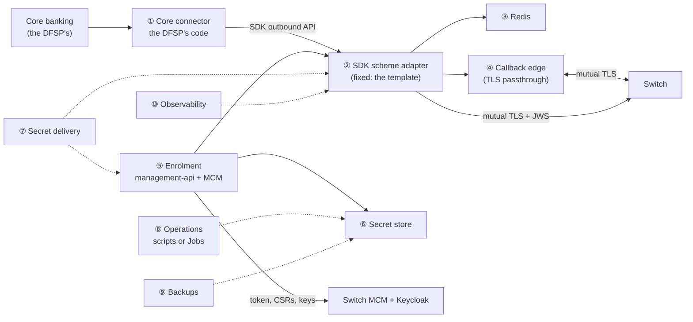
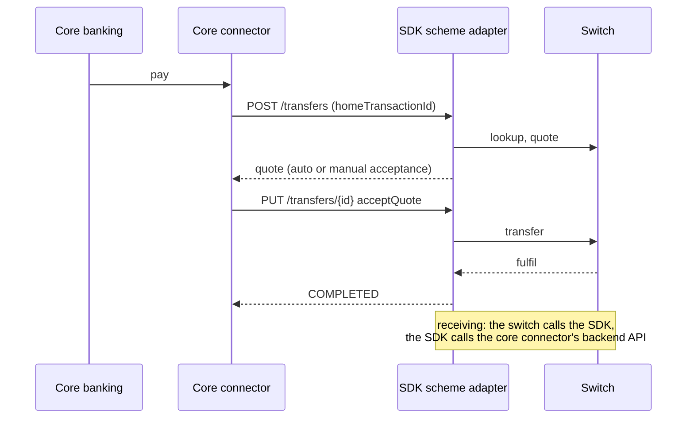
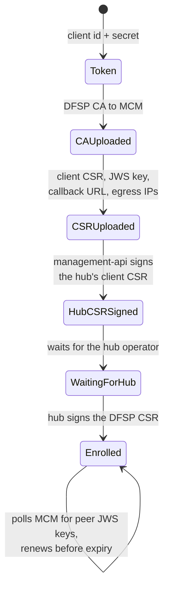

# Building blocks around the core connector

A DFSP brings one thing of its own: the **core connector**, which speaks to its
core banking system. Everything else the payment manager needs is a building
block with several interchangeable options. Pick one option per block; the
template wires them together and keeps the connection to the hub's MCM the same
whatever you choose.

## The choices

| # | Block | Options | Validated (2026-11-18, sbx UAT) | Files |
|---|---|---|---|---|
| ① | Core connector | the DFSP's own image; the template's simulator for tests | simulator + `test-backend/mojaloop-simulator.yaml` | `helm-values/values-pm4ml.yaml` (`mojaloop-core-connector`), `values-test-backend.yaml` |
| ② | SDK scheme adapter | fixed: v24.19.3, 2+ replicas, PDB, graceful stop | 300 payments on 3 replicas; pod kills | `values-pm4ml.yaml`, `post-render/` |
| ③ | Redis | **Sentinel HA with password** (production); managed Redis (ElastiCache, Azure Cache) with TLS; single Redis (tests) | HA: master killed, 60/60; single: crash, 13/60 | `redis/values-redis-ha.yaml`, `redis/redis.yaml` |
| ④ | Callback edge | L4 `LoadBalancer` (cloud, MetalLB, Octavia); NodePort behind F5/HAProxy TCP; Istio `PASSTHROUGH`; ingress-nginx SSL passthrough | L4 LoadBalancer | `networking/` |
| ⑤ | Enrolment | **MCM mode** (management-api enrols, renews, fetches peer keys); static mode (certificates by hand) | both | `values-pm4ml.yaml`, `values-static.yaml` |
| ⑥ | Secret store | **OpenBao** (static seal, unseals itself); **Vault** (key shares, = Compose); Vault/OpenBao with KMS seal; managed Vault; none (static mode) | OpenBao, Vault, static | `secret-store/` |
| ⑦ | Secret delivery | scripts (`create-mcm-secrets.sh`); the bootstrap Job; External Secrets Operator from a secrets manager | scripts; bootstrap logic | `scripts/`, `jobs/bootstrap.yaml` |
| ⑧ | Operations | shell scripts from a workstation; Kubernetes Jobs and CronJobs (below) | both | `secret-store/*.sh`, `jobs/` |
| ⑨ | Backups | backup CronJob to any S3 API; `backup.sh`; the platform's volume snapshots in addition | CronJob → S3, restore Job | `secret-store/backup-cronjob.yaml`, `jobs/restore.yaml` |
| ⑩ | Observability | Prometheus annotations on :4004; PodMonitor (Prometheus Operator); logs to Loki/ELK/CloudWatch | metrics read | `monitoring/podmonitor.yaml` |

Recommended production combination on any cluster: **③ Sentinel HA**, **④ L4
LoadBalancer on static IPs**, **⑤ MCM mode**, **⑥ OpenBao** (or Vault with a
KMS seal), **⑦ bootstrap Job or External Secrets**, **⑧ Jobs**, **⑨ backup
CronJob**, **⑩ PodMonitor**.

## The core connector's contract

The core connector is the only block the template does not provide. To work
with the rest it must:

| Requirement | Why |
|---|---|
| Call the SDK outbound API (`http://<release>-sdk-scheme-adapter-api-svc:4001`) inside the cluster; never expose it | It starts payments without authentication |
| Answer the SDK's backend calls (`BACKEND_ENDPOINT`): parties, quotes, transfers | That is how the DFSP receives payments |
| Keep a record of the payments it started, keyed by its `homeTransactionId`, and never resend one blindly | The SDK does not de-duplicate on it (tested: same id twice = two payments) |
| After any error or timeout, ask `GET /transfers/{transferId}` before retrying | A payment can be reported failed and still be committed (pod crash, node loss) |
| Run 2+ replicas with its own PDB and readiness probe | It is on the payment path like the SDK |
| Be sized and probed (the template's simulator needs 512 MiB) | It was OOM-killed at 256 MiB |

## A proper connection to MCM

What has to be true for management-api to enrol and stay enrolled:

| Item | Where | Check |
|---|---|---|
| DFSP id, exactly as the hub created it | `dfspId`, `DFSP_ID`, `AUTH_CLIENT_ID` | — |
| Client secret from the hub operator, via a secure channel | Secret `<release>-mcm` (or External Secrets) | no `401 invalid_client` in management-api's log |
| `MCM_SERVER_ENDPOINT=https://mcm.<switch>/pm4mlapi`, `HUB_IAM_PROVIDER_URL=https://keycloak.<switch>` | values | — |
| Egress to `mcm.`, `keycloak.`, `fspiop.` on 443, from fixed IPs | NAT / egress gateway | `WHITELIST_IP` = those IPs, bare IPv4 |
| The switch's TLS CA trusted, if it is a private CA | `NODE_EXTRA_CA_CERTS` on management-api | no `UNABLE_TO_VERIFY_LEAF_SIGNATURE` |
| Callback host reachable from the switch, in the server certificate's SAN | `MOJALOOP_CONNECTOR_FQDN`, `CALLBACK_URL`, CSR parameters, DNS | `openssl s_client -connect ml-connect.<domain>:443` shows `<dfsp> CA` as issuer |
| A DFSP CA in the store before management-api starts | `init.sh` or the bootstrap Job | `DFSP_CA_PROPAGATED` |
| The hub signs the request | hub operator, in MCM | `DFSP_CLIENT_CERT_CONFIGURED` |
| The store survives restarts and is backed up | PVC + backup CronJob | the restore Job brings back the same CA |

## Operations: scripts or Kubernetes Jobs

Every operational step exists both as a script (run from a workstation with
`kubectl`) and as a Kubernetes object (runs in the cluster, auditable, no
workstation access to the namespace needed):

| Step | Script | Kubernetes object | Needs |
|---|---|---|---|
| Initialise and configure the store, AppRoles, DFSP CA | `secret-store/init.sh` | `jobs/bootstrap.yaml` (Job) | a Role on Secrets (included) |
| Runtime secrets: ILP, Redis URL/password, placeholders | `scripts/create-mcm-secrets.sh` | `jobs/bootstrap.yaml` | same Job |
| Backups to S3 | `secret-store/backup.sh save` | `secret-store/backup-cronjob.yaml` (CronJob) | an S3 bucket Secret |
| Restore after losing the store | `secret-store/backup.sh restore` | `jobs/restore.yaml` (Job) | the same bucket Secret |
| Unseal Vault after a restart | `secret-store/unseal.sh` (custodians) | `jobs/vault-unsealer-cronjob.yaml` (CronJob) | the key shares in a Secret: see its trade-off |
| Break-glass identity export | `scripts/export-identity.sh` | (snapshots cover it) | — |

Validated: the bootstrap logic end to end (initialise, CA, AppRoles, secrets;
idempotent re-run; refuses to initialise when it cannot save the keys), the
backup CronJob to an S3 API, the restore Job (same CA after losing the store),
the unsealer CronJob (Vault unsealed 40 s after a restart). The bootstrap
Job's Role could not be created on the test cluster, so its script was run
with the operator's rights against the same store.

## A production-ready cluster

| Area | Requirement |
|---|---|
| Nodes | 3+ nodes over failure domains; the SDK and Redis spread (anti-affinity) |
| Storage | encrypted volumes, the store and Redis on PVCs, volume snapshots by the platform in addition to the store's own |
| Network | a CNI enforcing NetworkPolicies (the template ships them for the store and Redis); egress through fixed IPs |
| Access | namespace-scoped RBAC for the DFSP team; the store's root token and unseal material outside the cluster |
| Secrets | Kubernetes Secrets encrypted at rest (KMS provider); External Secrets for anything sourced elsewhere |
| Workloads | requests/limits, PDBs, readiness probes, pinned image versions, non-root containers |
| Upgrades | `helm upgrade` with the post-renderer; drain nodes one at a time (PDBs keep payments flowing) |
| Observability | metrics, logs and alerts on: payments sent but not answered, event-loop lag, management-api down, certificate expiry, backup age |
| Recovery | a restore rehearsed once per quarter with the restore Job |
