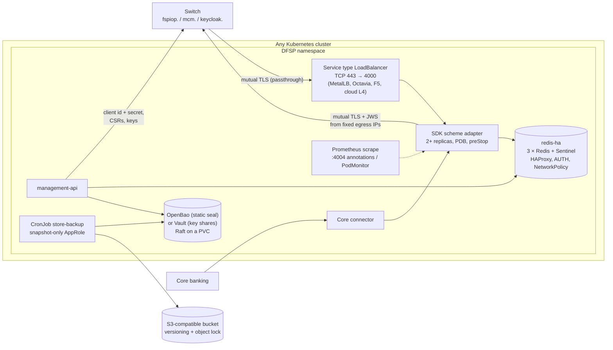
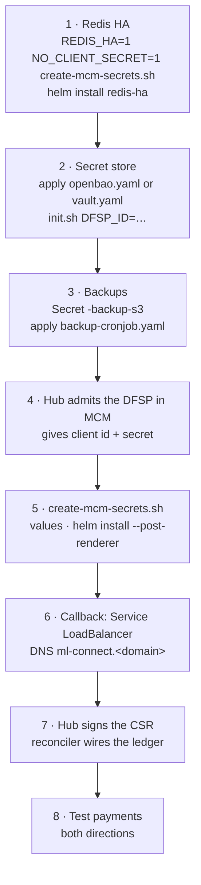
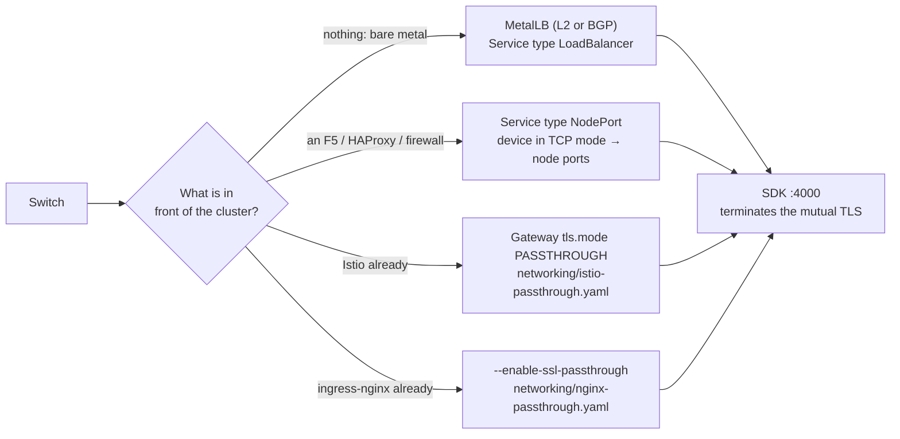

# PM4ML on any Kubernetes

The reference with no cloud service at all: everything the DFSP needs runs in
its cluster, and the only outside dependencies are an L4 load balancer (or two
public node ports), DNS, and an S3-compatible bucket for backups. This is what
was validated on 2026-11-18, on a plain Kubernetes cluster on OpenStack
(Cilium enforcing NetworkPolicies, Octavia L4 load balancers), against the sbx
UAT switch. For a cloud mapping see [PRODUCTION.md](PRODUCTION.md).



## What the cluster must provide

| Need | Minimum | Checked by |
|---|---|---|
| Kubernetes | 1.27+ | `kubectl version` |
| Persistent volumes | A default StorageClass; encrypted and backed up by the platform if possible | The store and Redis PVCs bind |
| L4 load balancer or reachable node ports | One public TCP 443 for `ml-connect.<domain>`, passed through to the SDK | `openssl s_client` returns the DFSP's server certificate (below) |
| NetworkPolicy enforcement | A CNI that enforces them (Cilium, Calico) | Another namespace's pod cannot reach Redis |
| Fixed egress IPs | NAT or egress gateway; these go into `WHITELIST_IP` | The hub sees them |
| DNS | `ml-connect.<domain>` → the load balancer | `dig` |
| Object storage | Any S3 API (MinIO, Ceph RGW, provider object storage) | The backup job uploads |

Namespaces: one per DFSP and environment is simplest. Several DFSPs can share
one, with a release name each (`RELEASE=` and `scripts/for-release.sh`): that is
how the two test DFSPs ran.

## Install, end to end



```bash
NS=<namespace>; R=pm4ml        # R: Helm release name; one DFSP per release
helm repo add pm4ml https://pm4ml.github.io/mojaloop-payment-manager-helm/repo
helm repo add dandydeveloper https://dandydeveloper.github.io/charts
helm repo update

# 1. Redis HA, with a generated password (Secrets $R-redis-auth, $R-runtime)
NS=$NS RELEASE=$R REDIS_HA=1 NO_CLIENT_SECRET=1 ./scripts/create-mcm-secrets.sh   # the client secret comes in step 5
./scripts/for-release.sh $R redis/values-redis-ha.yaml > /tmp/redis-ha.yaml
helm upgrade --install $R-redis dandydeveloper/redis-ha --version 4.35.5 -n $NS -f /tmp/redis-ha.yaml

# 2. Secret store: OpenBao (unseals itself) ...
kubectl -n $NS create secret generic $R-openbao-seal --from-file=unseal.key=<(openssl rand 32)
#    back that Secret up NOW, somewhere other than the snapshots
./scripts/for-release.sh $R secret-store/openbao/openbao.yaml | kubectl -n $NS apply -f -
NS=$NS RELEASE=$R STORE=openbao DFSP_ID=<dfsp id> ./secret-store/init.sh
#    ... or Vault: secret-store/vault/vault.yaml, STORE=vault, then 3 custodians keep the key shares
#    move ./$NS-$R-store-init.json (recovery/unseal keys, root token) to escrow and delete it

# 3. Backups to any S3-compatible bucket, every 6 hours
kubectl -n $NS create secret generic $R-backup-s3 \
  --from-literal=AWS_ACCESS_KEY_ID=... --from-literal=AWS_SECRET_ACCESS_KEY=... \
  --from-literal=AWS_DEFAULT_REGION=us-east-1 --from-literal=S3_BUCKET=<bucket> \
  --from-literal=S3_ENDPOINT=https://<s3 endpoint>
./scripts/for-release.sh $R secret-store/backup-cronjob.yaml | kubectl -n $NS apply -f -
kubectl -n $NS create job $R-store-backup-now --from=cronjob/$R-store-backup   # try it once

# 4. Hub operator: adds the DFSP in MCM, hands over the client id + secret.
# 5. Secrets and PM4ML
NS=$NS RELEASE=$R REDIS_HA=1 ./scripts/create-mcm-secrets.sh      # enter the client secret
./scripts/for-release.sh $R helm-values/values-pm4ml.yaml > values-$R.yaml   # fill every CHANGE ME
#    in values-$R.yaml: redis.host = $R-redis-ha-haproxy, VAULT_ENDPOINT stays http://$R-vault:8200
helm upgrade --install $R pm4ml/mojaloop-payment-manager --version 10.3.6 -n $NS \
  -f values-$R.yaml --post-renderer ./post-render/post-render.sh

# 6. Callback host
./scripts/for-release.sh $R networking/loadbalancer.yaml | kubectl -n $NS apply -f -
kubectl -n $NS get svc $R-callbacks        # EXTERNAL-IP → DNS ml-connect.<domain>
```

7. The hub operator signs the enrolment in MCM; the hub's reconciler creates
   the participant and wires the callbacks (no switch change is needed).
8. Check, then pay (the `test-backend/` scripts drive the SDK from inside the
   cluster when no core connector exists yet):

```bash
openssl s_client -connect ml-connect.<domain>:443 -servername ml-connect.<domain> </dev/null 2>/dev/null \
  | openssl x509 -noout -subject -issuer          # issuer: "<dfsp id> CA", not a public CA
kubectl -n $NS logs deploy/$R-management-api | grep -oE '"eventType":"[A-Z_]+"' | sort | uniq -c
#   DFSP_CA_PROPAGATED, DFSP_SERVER_CERT_CONFIGURED, HUB_CLIENT_CERT_SIGNED, DFSP_CLIENT_CERT_CONFIGURED
```

## Publishing the callback without a cloud load balancer



Whatever the choice: TCP pass-through, TCP health checks, a source restriction
to the switch's egress IPs, no proxy protocol, idle timeout ≥ 60 s. The cluster
used for the validation had an ingress-nginx without SSL pass-through, so the
callbacks used `Service type LoadBalancer` instead; an ingress that terminates
TLS cannot carry them.

## Day 2

| Task | Command |
|---|---|
| Every step as a Kubernetes Job/CronJob instead of a script | `jobs/` (bootstrap, restore, Vault unsealer) and `secret-store/backup-cronjob.yaml`; see [BUILDING-BLOCKS.md](BUILDING-BLOCKS.md#operations-scripts-or-kubernetes-jobs) |
| Backup now | `kubectl -n $NS create job $R-store-backup-now --from=cronjob/$R-store-backup` |
| Restore after losing the store | `jobs/restore.yaml` (latest snapshot from the bucket), or by hand: `INIT_ONLY=1 ./secret-store/init.sh`, `ROOT_TOKEN=<that init's root token> ./secret-store/backup.sh restore <file>`; then restart management-api ([PRODUCTION.md](PRODUCTION.md)) |
| Vault sealed after a restart | `NS=$NS RELEASE=$R ./secret-store/unseal.sh` (payments continue meanwhile) |
| Break-glass copy of the keys | `NS=$NS RELEASE=$R STORE=openbao OUT=/secure/dir ./scripts/export-identity.sh` |
| Rotate the MCM client secret | `NS=$NS RELEASE=$R ROTATE_CLIENT_SECRET=1 ./scripts/create-mcm-secrets.sh`, restart management-api |
| Scale | `scheme-adapter.sdk-scheme-adapter-api-svc.replicaCount` (validated with 3) |
| Upgrade | `helm upgrade` with the same values and `--post-renderer`; the PDB and preStop keep payments in flight |

## What was validated here

On the generic cluster, against sbx UAT, two DFSPs (one per release, same
namespace): onboarding through MCM, send and receive, 300 payments on 3
replicas, pod kills with and without graceful stop, Redis-HA failover with
AUTH and NetworkPolicies, Vault sealed, OpenBao restore from a snapshot,
static mode, and the backup CronJob uploading a snapshot to an S3-compatible
bucket (an in-cluster S3 mock). Details and numbers: the README's Validation
section.
