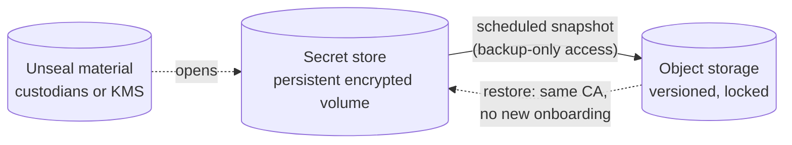
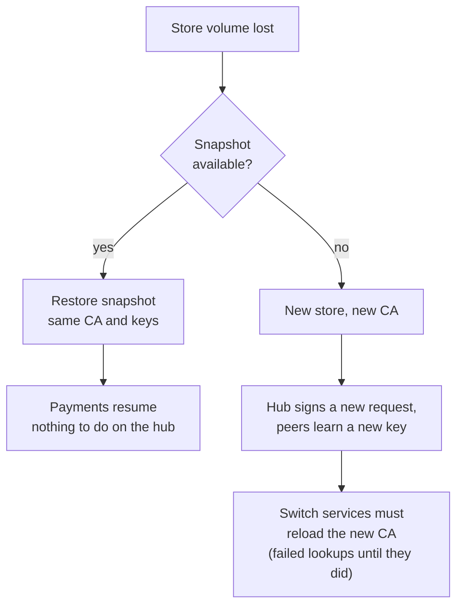
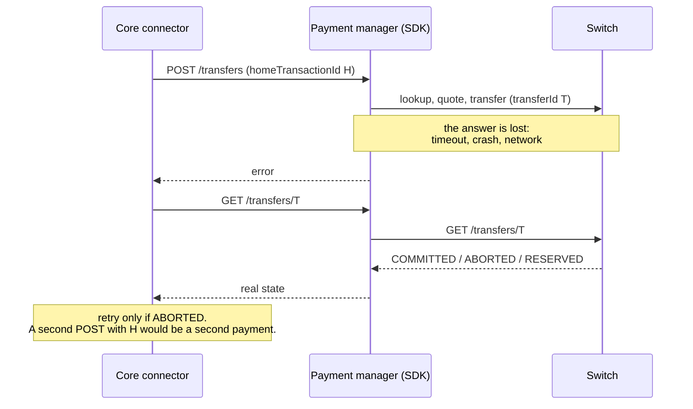
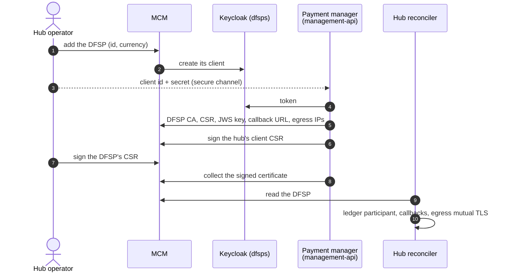
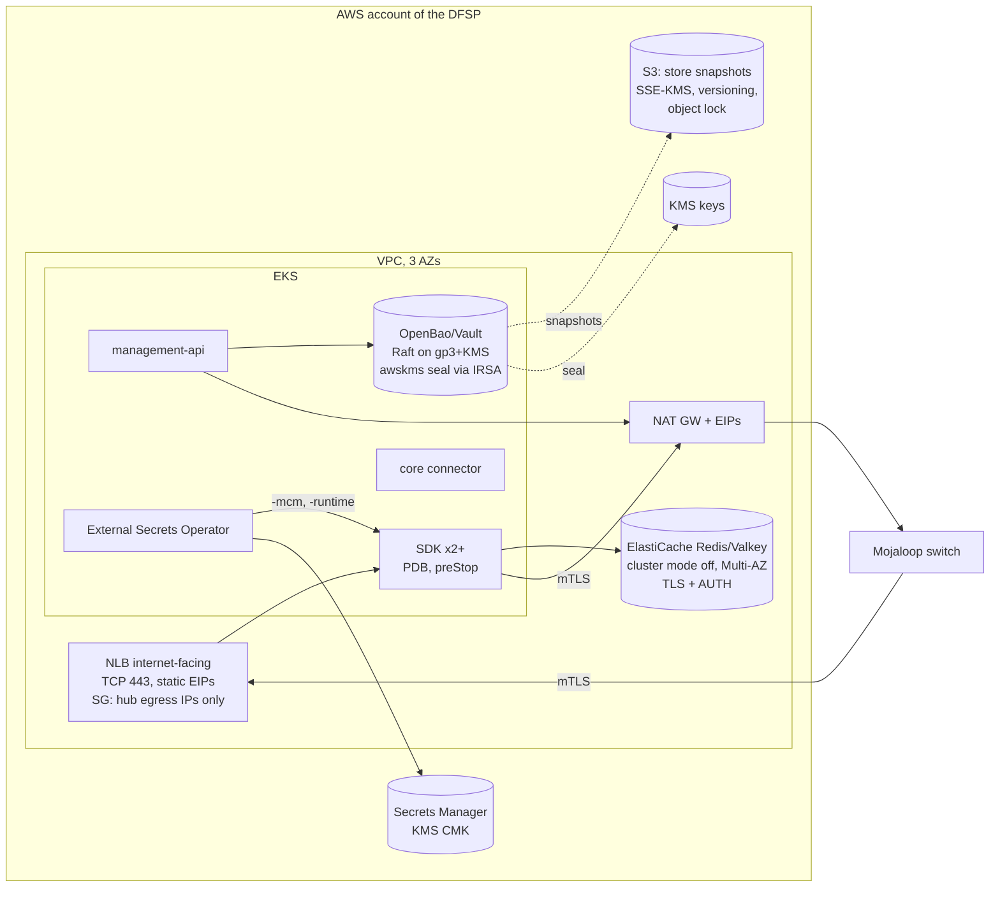

# Running PM4ML in production

How to keep a DFSP's keys safe, what has to survive a restart, how to publish
the callback host for mutual TLS, and how the same deployment maps onto AWS,
Azure or on-premises. Each recommendation says whether it was tested.

## What the DFSP holds, where it lives, what happens if it is lost

| Item | Secret? | Lives in | If lost |
|---|---|---|---|
| **DFSP CA private key** | critical | secret store: `pki/` | Onboard again: new CA in MCM, new CSR signed by the hub, every peer and the hub must pick up the new CA. **Tested: the hub's lookup service kept the old CA and refused our callbacks (`1001`) until its pods restarted.** Never lose it |
| Client certificate + key (signed by the hub CA) | secret | store: KV `secrets/state-machine-state` | New CSR, the hub operator signs again |
| Callback server certificate + key (signed by the DFSP CA) | secret | store, same | Re-issued by management-api, no hub action |
| JWS signing key | critical | store, same | New key; peers learn it from MCM within a poll. Messages signed with the old key in flight fail |
| Hub CA, peer JWS public keys | public | store, refreshed from MCM | Fetched again |
| MCM client secret | secret | Secret `<release>-mcm` | The hub operator re-issues it |
| ILP secret | secret | Secret `<release>-runtime` | Payments quoted under the old secret cannot complete; new ones work |
| Redis URL (may hold a password) | secret | Secret `<release>-runtime`, key `cache-url` | Re-enter it |
| Payments in flight | operational | Redis | Those payments fail; the ledger is consistent (reservations expire and are released). **Tested** |
| Unseal / recovery keys, root token | critical | outside the cluster (escrow) | Vault: the store cannot be opened again. OpenBao static seal: the seal key Secret is what matters |

So two things must survive anything: **the secret store's data** and **the
key that opens it**. Kept in different places.





## Keeping the store's data

1. **Persistent volume.** OpenBao and Vault run on a volume (`openbao.server.dataStorage`
   or `vault.server.dataStorage`, with `storageClass`). Use an encrypted,
   zone-redundant or snapshotted storage class (AWS gp3 with a KMS key, Azure
   Premium ZRS, Ceph). The chart refuses to render a store without a volume unless
   `store.acceptDataLoss` is set.
2. **Raft snapshots off-cluster.** The stores use Raft, which takes consistent
   online snapshots. The backup CronJob (`backup.enabled`, bucket credentials in
   the Secret named by `backup.s3Secret`) ships them to any S3-compatible bucket.
   Use a bucket with versioning and object lock. **Tested:** the store's volume
   deleted, the restore Job (`restore.enabled`) run: same CA fingerprint, no new
   enrolment in MCM, management-api resumed. See "Backups and restore" in the
   [chart README](../charts/pm4ml-dfsp/README.md#backups-and-restore).
3. **The unseal material elsewhere.** Vault: the 5 key shares with different
   custodians. OpenBao static seal: Secret `<release>-openbao-seal`, backed up
   to a different system than the snapshots. With a cloud KMS seal the key never
   leaves the KMS: back up nothing, but protect the KMS key from deletion.

Never `kubectl delete pvc` on the store to "start clean": that is the
"onboard again" row above.

## Choosing the pieces

| Piece | Option | Tested | Use when |
|---|---|---|---|
| Secret store | OpenBao 2.6.5, static seal (default) | ✓ incl. restart, Raft snapshot restore | Nobody can be on call to unseal |
| | Vault 1.13.3, Shamir (`presets/store-vault.yaml`, = Compose) | ✓ incl. restart, sealed state, unseal | Custodians can unseal after a restart (payments continue while it is sealed: tested) |
| | Vault/OpenBao with a cloud KMS seal | — | On AWS/Azure: the seal key stays in the KMS |
| | Managed Vault (HCP) | — | No store to operate |
| Redis | Valkey, single node (default) | ✓ | Test only: a crash failed 47 of 60 payments in flight |
| | Valkey HA: Sentinel + HAProxy (`presets/valkey-ha.yaml`) | ✓ master killed under load: 60/60; password on; another DFSP's pod cannot reach it | Production on any cluster |
| | Managed: ElastiCache / Azure Cache, primary endpoint, TLS + AUTH (`presets/redis-external.yaml`) | — | Cloud production; use the non-cluster mode (the SDK uses a single-node client) |

## Publishing the callback host: mutual TLS end to end

Two TLS legs, both mutual:

```
outbound  SDK ──(client cert signed by the HUB CA)──▶ fspiop.<switch>:443
                ◀─(hub server cert, verified with hub-ca.pem)──

inbound   hub ──(hub client cert signed by the DFSP CA)──▶ ml-connect.<dfsp>:443 ──▶ SDK :4000
                ◀─(DFSP server cert signed by the DFSP CA)─────────────────────────
```

The SDK itself terminates the inbound TLS: it holds the server key and checks
the hub's client certificate. So whatever sits in front of it must **pass TLS
through untouched**:

| Works | Does not work |
|---|---|
| L4 load balancer, TCP 443 → 4000 (AWS NLB, Azure Standard LB, Linode/OpenStack, MetalLB) | L7 load balancers that terminate TLS: AWS ALB, Azure Application Gateway, CloudFront, most WAFs |
| Istio Gateway `tls.mode: PASSTHROUGH` | An Istio/nginx route that terminates TLS and forwards HTTP |
| ingress-nginx with `--enable-ssl-passthrough` | ACM / Key Vault certificates on the listener (the hub would see a public cert, not the one MCM issued) |
| HAProxy/F5 in TCP mode | Proxy protocol (the SDK does not parse it) |

Settings that matter:

- **Source IP:** the hub's egress IPs are known: restrict the listener to them
  (`loadBalancerSourceRanges`, a security group). Keep the client IP
  (`externalTrafficPolicy: Local` or IP targets).
- **A stable address:** a DNS name for `ml-connect.<domain>`, ideally on
  static IPs, because the name is in the server certificate's SAN and in MCM.
- **Health checks:** TCP on the target port. An HTTPS check fails: it presents
  no client certificate.
- **Idle timeout** ≥ 60 s.
- **Egress:** the SDK and management-api reach `fspiop.`, `mcm.` and
  `keycloak.` from fixed egress IPs (NAT); put those, bare IPv4, in
  `WHITELIST_IP` so the hub can allow them.
- **Do not reuse** the callback key for anything else, and do not copy it to
  the load balancer.

Validated on 2026-11-18 with plain L4 `LoadBalancer` Services
(the chart's callback Service) on two DFSPs against sbx UAT.

## Idempotency: the core connector's part

The SDK de-duplicates per `transferId`, not per `homeTransactionId` (tested:
the same `homeTransactionId` twice is two payments). After any error, ask for
the transfer's real state before retrying:



Where the core connector gets `T`: keep quote acceptance manual
(`AUTO_ACCEPT_QUOTES=false`, the default here and in Compose). The SDK then
answers the first `POST /transfers` with the quote **and the `transferId`**, and
no money moves until the core connector sends `PUT /transfers/{T}` with
`acceptQuote: true`. So the core connector records `T` against `H` before the
only call that can move money, and after a lost answer to that call it always
has `T` to ask about. If the first `POST` itself gets no answer, nothing has
moved yet: the transfer is never prepared without the `PUT`, and the core
connector may start again (the SDK's error body carries `transferState.transferId`
when one was created). With automatic acceptance there is no such point: avoid
it, or reconcile by `H` against the switch's records before any retry.

## Onboarding sequence



## When a DFSP's CA changes: a note for the switch

Observed on sbx UAT (2026-11-18): after `pm4mlhelm01` was onboarded again with
a new CA, the hub reconciler updated `dfsp-egress-certs` and most switch
sidecars reloaded it (their istio-agent logged `read certificate from file`
for the new files), but the lookup service's sidecar kept verifying our
callback server certificate against the old CA (`CERTIFICATE_VERIFY_FAILED`,
`1001` for the payer). A restart of `mojaloop-account-lookup-service` fixed it:
60/60 payments afterwards. The stale pod was gone before its agent logs could
be read, so the cause is not proven.

For the switch (not changed here):
- after the reconciler rewrites a DFSP's CA, restart the egress consumers
  (lookup service, quoting, ml-api-adapter notification), or check that each
  sidecar serves the new CA (`istioctl proxy-config secret`);
- or move the DestinationRules to `credentialName` (SDS from a Secret per
  DFSP), which istiod pushes on every Secret change.

For the DFSP: the CA must not change in normal operation. That is what the
backups above are for.

## Reference: fully on AWS



| Concern | AWS service and setting |
|---|---|
| Cluster | EKS, managed node groups over 3 AZs; secrets envelope encryption with a KMS key; IRSA for anything that calls AWS |
| Callback host | NLB via the AWS Load Balancer Controller: `aws-load-balancer-type: external`, `aws-load-balancer-nlb-target-type: ip`, `aws-load-balancer-scheme: internet-facing`, `aws-load-balancer-eip-allocations` (one EIP per subnet), TCP listener 443 → 4000, cross-zone on, security group allowing the hub's egress IPs only. Route 53 `ml-connect.<domain>`. No TLS listener, no proxy protocol |
| Egress to the hub | NAT gateway per AZ with EIPs; those EIPs go in `WHITELIST_IP` |
| Redis | ElastiCache for Redis/Valkey, cluster mode disabled, Multi-AZ with automatic failover, encryption in transit and at rest, AUTH token. `cache-url = rediss://:<token>@<primary endpoint>:6379` stored in Secrets Manager |
| Secret store | OpenBao or Vault in-cluster on gp3 (KMS-encrypted) with the KMS seal (Vault `seal "awskms"`; OpenBao 2.7+ as a plugin, or 2.6 built in) through IRSA; Raft snapshots by a CronJob to S3. Or HCP Vault Dedicated in the same region (AppRole) |
| Other secrets | Secrets Manager, synced by External Secrets Operator into `<release>-mcm` (client secret) and `<release>-runtime` (ILP secret, Redis URL) |
| Not usable | AWS Secrets Manager or ACM as the store for management-api: it needs a Vault-API PKI (it signs CSRs). AWS Private CA could, but only with code changes. ALB for callbacks |
| Observability | Amazon Managed Prometheus (PodMonitor / annotations on :4004), CloudWatch Container Insights or Loki for logs, alerts from the PodMonitor (`monitoring.podMonitor.enabled`) |

## The same on Azure and on-premises

| Concern | Azure | On-premises |
|---|---|---|
| Callback host | Standard Load Balancer, static public IP, NSG with the hub IPs; not Application Gateway | MetalLB (L2/BGP) or F5/HAProxy in TCP mode |
| Redis | Azure Cache for Redis (Premium), non-clustered, TLS + access key | `presets/valkey-ha.yaml` on replicated storage |
| Store seal | Vault/OpenBao `azurekeyvault` seal with workload identity | OpenBao static seal (key in a separate secret system), or an HSM (PKCS#11) |
| Store data | Azure Disk Premium ZRS + snapshots to Blob (immutable) | Ceph/Longhorn + snapshots to an off-site object store |
| Secrets | Key Vault + External Secrets Operator | Vault/OpenBao of the platform team, or sealed-secrets |
